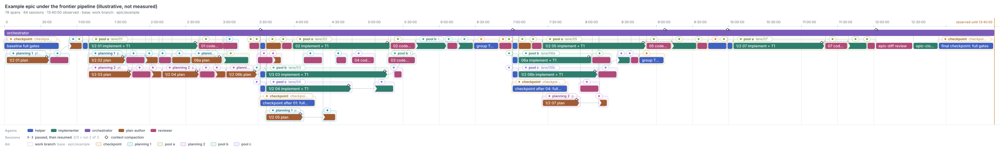

# Frontier Pipeline

> **Status: pilot.** This is the process the `scope` and `orchestrate` skills run for prototype-first work. It has not been formally adopted yet (ADR 0007 is pending), so the older process docs ([process.md](process.md), [orchestration.md](orchestration.md), [plan-levels.md](plan-levels.md)) still describe the previous path. **The skills are the source of truth**; this page is an overview with an example. Where they differ, the skills win.

## The shape

```
prototype ──► scope (with the human) ──► orchestrate (unattended) ──► PR process
  PROTOTYPE.md      epic.md or plan.md         child by child             pull-request
```

1. **Prototype** (`prototype`): a throwaway build, paired with the human, that shows the behaviour wanted. Its accepted demo becomes the acceptance scenarios.
2. **Scope** (`scope`): the orchestrator and the human agree what the real build covers, including what the prototype skipped. Small work becomes a single `plan.md`; anything bigger becomes an `epic.md` of numbered child plans. A fresh reviewer checks it; the human approves.
3. **Orchestrate** (`orchestrate`): runs every child through plan → build → review → integrate, without asking, until done or a stop condition fires.
4. **PR** (`pull-request`): the epic branch goes through the normal PR review.

## Roles

| Agent | Does | Session |
|---|---|---|
| orchestrator | Sequences the work, keeps `state.json`, decides; never plans, builds or reviews | One long session, self-compacts at clean points |
| plan-author | Writes a child's `plan.md`, revises it from review | Owns the plan until approved; resumed for fixes. Refreshes after approval are fresh sessions |
| implementer | Builds the whole plan, runs T1, fixes review findings | Owns the code until approved; resumed for fixes and integration conflicts |
| reviewer | Judges a plan, a refresh, a diff, an integration or the whole epic | Always fresh; commits only the ledger |
| oracle | Breaks ties and answers what would otherwise go to the human | Fresh |
| helper, researcher | Scouts, gate runs, digests, sweeps | Fresh, fast models |

## Artifacts

| File | What |
|---|---|
| `PROTOTYPE.md` | The prototype's handoff note: the behaviour it shows |
| `epic.md` | Goal, scope, acceptance scenarios, children (dependencies, estimate, claim), parallel groups, gates, checkpoints, review-load signal, budgets, autonomy, Decisions, Follow-ups, Quarantine |
| `state.json` | The orchestrator's memory: per-child status, runs, review passes, budgets; groups, checkpoints, launches, stops |
| `NN_slug/plan.md` | One child's plan: goal and estimate, design, changes, the contracts to test, T1 gates, claim, deliverables, risks, handoff. Under about 150 lines |
| `NN_slug/review.md` | The child's ledger: every review pass, the author's responses, the scout note, the implementer's evidence (gates with command line and tree, deliverables map) |

## Where work runs

Each worktree has one writer at a time.

| Worktree | Holds |
|---|---|
| Work branch | The epic branch. Only the orchestrator's files, plan merges and integration merges land here. Epic-close fixes run here |
| Planning (up to two) | A `plan/NN` branch per child, cut from the work-branch tip. Plan-authors and plan reviewers run here |
| Pool (lanes) | A `lane/NN` branch per child. Scout, refresh, implementer and code reviews run here. A lane holds its worktree until integrated |
| Checkpoint | Baseline and checkpoint full-gate runs, checkpoint fixes, and (when free) group integration |

Without a worktree pool there are no lanes: children run one at a time in the work-branch worktree.

## A child, start to finish

1. **Plan.** A plan-author writes the plan once every child it depends on has *started implementing*, so planning runs ahead of the build. A dependency not built yet is represented by its approved plan. A fresh reviewer reviews it.
   - Pass 2 is skipped when the reviewer says it isn't needed, there were no blockers, every major was fixed and none rejected, and no fix changed a contract.
   - On approval the plan branch merges into the work branch, and the child's budget is set from its estimate (implementer hours × 1.5, plus a fixed per-child cost).
2. **Start.** When its unit may start (below), the child gets a lane at the work-branch tip. A helper *scouts* what was integrated since the plan was cut. Only if something relevant changed does a fresh plan-author *refresh* the plan, reviewed once.
3. **Implement.** The implementer builds everything, running only fast T0 checks while building, then T1 once at the end. Its ledger entry records each gate's command line and tree, and maps every deliverable to its evidence.
4. **Code review.** Pass 1 reviews the child's whole diff against the plan. Later passes review only the fix range. Cap: 4 passes, then stop for the human.
5. **Close.** The child's unit integrates (below). The orchestrator updates the epic, starts every checkpoint and unit that is now ready, and self-compacts.

## Units, groups and claims

- **Unit:** a parallel group, or a child in no group (a group of one). Group members build at the same time and integrate together.
- **Start rule:** a unit starts when everything its members depend on is integrated, every member's plan is approved, and a pool worktree is free for each member. Units start in child-number order; a waiting unit holds back later ones.
- **Claims:** each child names the files, routes, tables and components it may change. Units with overlapping claims never run at once. A child that must go outside its claim reports it, and the orchestrator widens the claim or orders it after the holder.
- **Integration:**
  - *Group of one, plain merge:* if only orchestrator and plan files moved on the work branch since the lane's base, the lane merges directly; its own T1 is the proof.
  - *Otherwise:* lanes merge into an `integration/<group>` branch in child order. A conflict goes back to that member's implementer. A helper runs the group T1. An integration review runs only if an integrator changed something. Then the integration branch merges into the work branch.

## Verification tiers

| Tier | When | What |
|---|---|---|
| T0 | While building | Related tests, one E2E spec, incremental typecheck |
| T1 | Once per child, and per group integration | Typecheck/build of touched packages, lint on changed files, selected units, the child's E2E specs plus test-map specs and smoke set; widened or escalated by the plan |
| Full gates | Baseline, checkpoints, epic close | Everything, off the critical path except at epic close |

A gate is never rerun on the same tree with the same command line.

**Checkpoints** are named after a child and run in the checkpoint worktree once that child and its dependencies are integrated. They don't hold back starting or integrating children. A red checkpoint is fixed on the checkpoint branch; only children that build on the broken code are paused (`orchestrate/references/checkpoint-failures.md`).

## Sizing

The review-load signal (default about 7k changed lines) is what a reviewer can judge in one pass. A child above it is split only if its concerns are separable *and* the pieces can run as parallel lanes. Every child adds a fixed cost to the critical path (plan loop, review loop, integration) that only parallel lanes hide, so serial work stays whole. Groups are chosen by content, never by size.

## Stops

The orchestrator decides everything else, recording tricky calls under Decisions. It stops for the human when:
- the scope or a premise of the prototype would change;
- an action is destructive, irreversible, or needs a push or merge the epic didn't pre-authorize;
- a review loop hits its cap, a child exceeds its budget, or an environment failure persists;
- a gate failure can't be fixed and isn't in the baseline;
- a course-setting decision has no clearly better option, even for the oracle.

## Example execution

An illustrative epic of seven children on a pool of three worktrees. The durations are made up but of a realistic order; nothing here is measured.



| Child | Depends on | Unit | What the run shows |
|---|---|---|---|
| 01 | — | group of one | Plan pass 2 skipped; plain merge at about 3:30 |
| 02, 03, 04 | 01 | group G1 | Planned while 01 builds; start together once 01 integrates. 02's scout finds 01's changes relevant, so it gets a refresh. 03 hits an integration conflict, which its own implementer resolves; group T1 and an integration review follow |
| 05 | 03 | group of one | Planned once 03 starts building. Starts before G2 because it is lower-numbered. Its integration needs a T1, because G2 and a checkpoint moved the work branch meanwhile |
| 06 → 06a, 06b | 01 | new group G2 | 06's planner finds two separable concerns and proposes a split. The pieces wait for free worktrees, then build and integrate together |
| 07 | 02, 05 | group of one | Plain merge; then the epic-diff review, its fixes and the final checkpoint |

What to notice:
- **Planning runs ahead.** Both planning worktrees stay busy while lanes build, so a unit rarely waits for its plan.
- **Checkpoints run beside the work.** The checkpoints after 01 and after 04 never block a child; only the final checkpoint is on the critical path.
- **Fixed cost per child.** Even a clean child spends about an hour in plan loop, scout, reviews and integration on top of its build. That is why children are slices worth that cost, and why parallel lanes matter.

### Regenerating the diagram

The diagram is a [Work Trace](https://github.com/smantzavinos/work-trace) built from a hand-written scenario. Edit `diagrams/example-epic.scenario.json` (steps with durations, worktrees, branches and `after` dependencies), then:

```
node tools/scenario-trace.mjs docs/diagrams/example-epic.scenario.json \
  -o docs/diagrams/example-epic.trace.json --validate-with <work-trace checkout>
node tools/work-trace-render.mjs --work-trace <work-trace checkout> --width 3200 docs/diagrams/example-epic.trace.json
```

Open the `.trace.json` in the Work Trace viewer for details per span. `tools/pi-work-trace.mjs` builds the same format from recorded Pi sessions, so a real run can be compared with this one.

## History

- `plans/2026_10_10_frontier_pipeline/`: the original design and pilot evaluation.
- `plans/2026_10_13_fast_verification/`: verification tiers, lanes and checkpoints, and the changes made during the pilot.
- `plans/2026_10_15_process_retro/retro.md`: what the pilot showed.
- `plans/2026_10_16_pipeline_tuning/`: the changes adopted from the retro (units and claims, refresh only on relevant change, conditional plan pass 2, fix-range code review, deliverables map).
