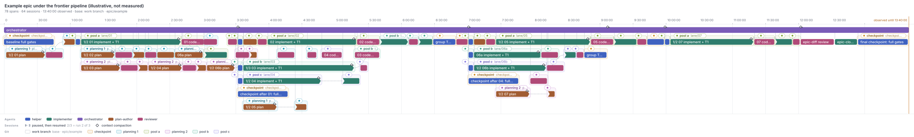

# Frontier Pipeline

> **Status: pilot.** This is the process the `scope`, `run-plan` and `run-epic` skills run for prototype-first work. It has not been formally adopted yet (ADR 0007 is pending), so the older process docs ([process.md](process.md), [orchestration.md](orchestration.md), [plan-levels.md](plan-levels.md)) still describe the previous path. **The skills are the source of truth**; this page is an overview with an example. Where they differ, the skills win. The design and its reasons are in `plans/2026_10_21_architecture_driven_plans/plan.md`.

## The shape

```
prototype ─► scope (with the human) ───────────────► run-plan (unattended) ─────────────────► PR process
PROTOTYPE.md   plan.md + model + tour                 build, code tagged ─► model checks        pull-request
               ─► review ─► the human approves        ─► code review + T1 ─► full gates
                  from the tour                        ─► checks again ─► as-built tour
               └─► epic.md (rare) ─► run-epic: per child, a plan loop and the same build loop
```

1. **Prototype** (`prototype`): a throwaway build, paired with the human, that shows the behaviour wanted. Its accepted demo becomes the acceptance scenarios.
2. **Scope** (`scope`): the orchestrator and the human agree what the real build covers, including what the prototype skipped. The default is **one plan, as large as the work needs**. A plan-author writes a short `plan.md` and a model; a fresh reviewer checks both; the human approves from the model's tour, and `scope` records the approval.
3. **Run plan** (`run-plan`): one implementer builds the whole plan and tags the code. The model is checked against the code, a fresh reviewer and T1 run side by side, then the full gates and the checks again. It stops only if the build needs the human to re-approve a change to what they approved.
4. **PR** (`pull-request`): the branch goes through the normal PR review, with what shipped against what was approved, and the as-built tour.

An **epic** (`run-epic`) is the rare case: genuinely distinct workstreams, each with its own plan and model. Work is never divided to meet a size number.

## The model

A plan's design is a model: a JSON file the diagram tool (`c4ish`) validates and draws. The rules are in the `architecture-model` skill; in short:

- **Built from a catalog.** The project keeps a catalog of its patterns (the contract: [references/pattern-catalog.md](references/pattern-catalog.md); written from existing code with `map-patterns`). Every element that lives in code follows a catalogued pattern, is a partial fit, proposes a new pattern, or is bespoke with a reason.
- **One home per kind of content.** The model says what is built and how the pieces connect. `plan.md` says why, and what proves it. The tour says in what order to look.
- **Tags.** The build tags each definition it creates or changes with its pattern (`@pattern <id>`). Review reads by pattern state: it skips only what a passing rule proves, and reads one-offs and deviations in full.
- **Three checks.** The model validates and its tour walks every scenario (plan time). The model agrees with the code (before code review, and at close). Every difference between the approved model and the shipped one is a recorded deviation (the same).
- **Deviations** are a detail, a model change the reviewer judges, or a re-approval that stops for the human.
- **Approvals are recorded** as lines in `plan.md` naming a commit. Only the session that receives the human's approval writes one.

## Roles

| Agent | Does | Session |
|---|---|---|
| orchestrator | Sequences the work, keeps `state.json`, shows the tour, records approvals, decides; never plans, builds or reviews | `scope`, then `run-plan` (or `run-epic`); self-compacts at clean points |
| plan-author | Writes `plan.md` and the model, revises them from review | Owns the plan until approved; resumed for fixes. Refreshes after approval are fresh sessions |
| implementer | Builds the whole plan, tags the code, keeps the model in line, runs the model checks and T1's fast gates, fixes review and T1 findings | Owns the code until approved; resumed for fixes |
| reviewer | Judges a plan and its model, a diff against the approved model, an integration or a whole epic; owns the verdict on the model checks | Always fresh; commits only the ledger |
| oracle | Breaks ties and answers what would otherwise go to the human | Fresh |
| helper, researcher | Scouts, T1 and gate runs, the checks at close, digests, sweeps | Fresh, fast models |

## Skills

| Skill | Who uses it | For |
|---|---|---|
| `prototype`, `scope`, `run-plan`, `run-epic` | The human starts them | The steps above |
| `plan`, `implement`, `review` | plan-author, implementer, reviewer | Each role's job |
| `architecture-model` | Every role | The shared rules for the model, tags, checks, deviations and approvals; ships the check (`tools/model-check.mjs`) |
| `map-patterns` | The human starts it | Writing the project's pattern catalog from the code that exists |
| `assess-repo` | The human starts it | Checking that a repo has what the process needs, including the catalog set-up |
| `delegate`, `test-quality` | Every role | Offloading read-heavy work; which tests to write and keep |

## Artifacts

| File | What |
|---|---|
| `PROTOTYPE.md` | The prototype's handoff note: the behaviour it shows |
| `plan.md` | Goal and estimate, design decisions, changes outside the model, scenarios, the contracts to test, T1 gates, deliverables, risks, handoff, and the approval lines. Under about 120 lines |
| `model.c4ish.json` | The design: elements with change state, pattern state and code references; relationships; contracts; notes; scenarios; one review tour. Diagrams and tour pages are generated from it, never committed |
| `review.md` | The ledger: every review pass, the author's responses, the implementer's evidence (gates and model checks with command line and tree, deliverables map) and the recorded deviations |
| `state.json` | The orchestrator's memory: approvals, runs, review passes, budgets, launches, stops |
| The path file, catalog docs and profile | Project-owned, outside any plan: where the catalog lives and what the checks leave out |
| `epic.md` (epics only) | Goal, scope, scenarios, children, cross-plan contracts, proposed patterns, claims, groups, gates, checkpoints, budgets, autonomy, Decisions, Follow-ups, Quarantine |

## A plan, start to finish

1. **Plan.** A plan-author writes `plan.md` and the model against the catalog, and validates the model. A fresh reviewer reviews both. Pass 2 is skipped when the reviewer says it isn't needed, every major was fixed and none rejected, and no fix changed a contract.
2. **Approve.** `scope` gives the human the tour, the link to `plan.md` and a short list: scenarios, proposed patterns, bespoke elements and open questions. Approving the plan approves its catalog changes. `scope` records `Approved: <date> <commit>` and stops; the human starts `run-plan`.
3. **Implement.** The implementer builds everything, running only fast T0 checks while building. It reads each pattern's entry and golden example, tags what it creates or changes, and handles a departure from the model by its class. At the end it makes the code references exact, runs the model checks and T1's fast gates, and records the exact command lines for the rest of T1.
4. **Code review and T1, side by side.** A fresh reviewer and a T1 helper start together on the implementer's commit. The reviewer reruns the model checks, confirms the approval lines, reads the unaccounted lines, judges each deviation, then reads the code by pattern state. Approved and green goes to close; otherwise the implementer fixes the findings and the red T1 failures together.
   - Later passes review only the fix range. A diff above the review-load estimate is read in groups by container (untested).
   - Cap: 4 passes, T1-only fix passes included, then stop for the human.
5. **Re-approval,** when the build must change what the human approved: the implementer commits and stops; `run-plan` shows the human a tour of only what differs. They approve (recorded as `Re-approved:`), ask for changes, or reject.
6. **Close.** A helper runs the full gates once, and reruns the model checks on the final commit. The PR gets approved versus shipped, the as-built tour and the recorded deviations.

## Epics

Rare, and untested since plans gained a model. `run-epic` adds what crosses plans; each child is planned and built as above, in its own worktree.

- **Models:** each child has its own detailed model. `epic.md` names each cross-plan contract and the child that owns it, and claims each pattern a child will propose. There is no detailed model of the whole epic.
- **Approval:** who approves each child's plan follows the epic's Autonomy. A child that changes the catalog always stops for the human.
- **Worktrees** (one writer each): the work branch (the orchestrator's files, plan and integration merges); up to three planning worktrees; a pool of lanes, one per child being built; a checkpoint worktree for full-gate runs and fixes. Without a pool, children run one at a time.
- **Planning runs ahead:** a child is planned once every child it depends on has started implementing. At its start a helper scouts what was integrated since; only a relevant change triggers a plan refresh.
- **Units, groups and claims:** a unit is a parallel group, or a child in no group. It starts when everything its members depend on is integrated, every member's plan is approved and a lane is free for each. Each child claims the directories, routes, tables and components it may change; units with overlapping claims never run at once.
- **Integration:** a group of one merges directly when only orchestrator and plan files moved meanwhile. Otherwise lanes merge into an integration branch in child order, a helper runs the group T1, and an integration review runs only if an integrator changed something.
- **Checkpoints** are named after a child and run the full gates in the checkpoint worktree once that child and its dependencies are integrated. They don't hold back other children. A red one is fixed on the checkpoint branch (`run-epic/references/checkpoint-failures.md`).
- **Epic close:** the epic-diff review and the final checkpoint run side by side; then the fixes, T1 on the merged tip, and the PR process.

## Verification tiers

| Tier | When | What |
|---|---|---|
| T0 | While building | Related tests, one E2E spec, incremental typecheck |
| T1 | Per review pass (fast gates by the implementer, units and E2E by a helper beside the review), and per group integration | Typecheck/build of touched packages, lint and the pattern rules on changed files, selected units, the plan's E2E specs plus test-map specs and smoke set; widened or escalated by the plan |
| Model checks | Before each code review, in it, and at close | `c4ish validate --strict` and `model-check all` |
| Full gates | Baseline, a plan's close, an epic's checkpoints | Everything, off the critical path |

A gate is never rerun on the same tree with the same command line.

## Sizing

A plan is as large as the work needs. Each extra plan adds a fixed cost (plan loop, review loop, integration) and cuts one design into pieces the human has to hold together. The review-load estimate (default about 7k changed lines) is recorded, not a limit: above it, the code is reviewed in groups.

## Stops

The orchestrator decides everything else, recording tricky calls. It stops for the human when:
- the build needs re-approval, or (in an epic) a child's plan needs their approval;
- the scope or a premise of the prototype would change;
- an action is destructive, irreversible, or needs a push or merge that wasn't pre-authorized;
- a review loop hits its cap, the build exceeds its budget, or an environment failure persists;
- a gate failure can't be fixed and isn't in the baseline;
- a course-setting decision has no clearly better option, even for the oracle.

## Example epic execution

A simulated epic of seven children, with four lanes and three planning worktrees, as `run-epic` schedules it. It predates plan models and the size rule: child 06 is split for size here, which would not happen now, and no approval or model-check step is shown. It is scheduled by `tools/process-sim.mjs` under the skills' rules, with each step's duration set to the median of that step in the pilot (fast-verification eras). Medians hide the long tail, and no failure paths are shown, so read it for shape, not as a forecast. It takes 4h16; `plans/2026_10_20_process_variants/` compares it with other process variants on the same epic.



How to read it: each band is a work item (a child, an integration, a checkpoint or epic close), with its steps numbered in order. Bar colour is the agent; the boxed region and tag above a bar are the worktree and branch it ran in. Arrows are handoffs, labelled by kind (`review`, `fixes`, `start`, `merge`, `split`, …). A long `start` arrow is a child with an approved plan waiting for its unit to start.

| Child | Depends on | Unit | What the run shows |
|---|---|---|---|
| 01 | — | group of one | The foundation, including the contracts the others need. Plan pass 2 skipped; a `design` major means code pass 2; plain merge at about 1:34 |
| 02, 03, 04 | 01 | group G1 | Planned while 01 builds; start together once 01 integrates. 02's scout finds 01's changes relevant, so it gets a refresh. 04's `tests` major skips code pass 2. 03 hits an integration conflict, which its own implementer resolves; group T1 and an integration review follow |
| 05 | 01 | group of one | Needs only 01's contracts, so it doesn't wait for 03. Starts as soon as its plan is approved and a lane is free. Its integration needs a T1, because G1 and a checkpoint moved the work branch meanwhile |
| 06 → 06a, 06b | 01 | new group G2 | 06's planner finds two separable concerns and proposes a split. The pieces wait for two free lanes, then build and integrate together |
| 07 | 01 | group of one | Needs only 01's contracts. Waits for a lane while G1 and 05 hold all four, then the epic close: review and final checkpoint side by side, fixes, T1 on the merged tip |

What to notice:
- **Planning runs ahead.** The planning worktrees stay busy while lanes build, so a unit rarely waits for its plan.
- **T1 runs beside the review.** Each review pass and its T1 overlap, so neither adds to the other.
- **Checkpoints run beside the work.** One holds the checkpoint worktree that 05's integration needs, for about 5 min; the final one overlaps the epic-diff review.
- **Lanes are the limit.** With the chain short, G1 and 05 fill the four lanes; G2 and 07 wait until G1 integrates.
- **Fixed cost per child.** On top of its build, a child spends about 20 min on the critical path in scout, review, fixes and integration, plus a plan loop of about 30 min that usually runs ahead. That is why children are slices worth that cost, and why parallel lanes matter.

### Regenerating the diagram

The diagram is a [Work Trace](https://github.com/smantzavinos/work-trace). `diagrams/example-epic.epic.json` holds the epic: children with dependencies, builds and which ones get fixes, refreshes or a conflict; groups, checkpoints, lanes, planning worktrees and the step durations. `tools/process-sim.mjs` schedules it under the skills' rules into a scenario, which `tools/scenario-trace.mjs` turns into a trace:

```
node tools/process-sim.mjs docs/diagrams/example-epic.epic.json -o docs/diagrams/example-epic.scenario.json
node tools/scenario-trace.mjs docs/diagrams/example-epic.scenario.json \
  -o docs/diagrams/example-epic.trace.json --validate-with <work-trace checkout>
node tools/work-trace-render.mjs --work-trace <work-trace checkout> --width 3200 docs/diagrams/example-epic.trace.json
```

Open the `.trace.json` in the Work Trace viewer for details per span. `tools/pi-work-trace.mjs` builds the same format from recorded Pi sessions, so a real run can be compared with this one.

## History

- `plans/2026_10_10_frontier_pipeline/`: the original design and pilot evaluation.
- `plans/2026_10_13_fast_verification/`: verification tiers, lanes and checkpoints, and the changes made during the pilot.
- `plans/2026_10_15_process_retro/retro.md`: what the pilot showed.
- `plans/2026_10_16_pipeline_tuning/`: the changes adopted from the retro (units and claims, refresh only on relevant change, conditional plan pass 2, fix-range code review, deliverables map).
- `plans/2026_10_20_process_variants/`: simulated process variants and where a single plan's time goes.
- `plans/2026_10_20_pipeline_throughput/`: the changes adopted from them (contract-first dependencies, T1 beside code review, conditional code pass 2, final checkpoint beside the epic review, three planning worktrees).
- `plans/2026_10_21_architecture_driven_plans/`: plans whose design is a model built from a pattern catalog, approval from a tour, the model checks, and `run-plan` / `run-epic` in place of `orchestrate`.
