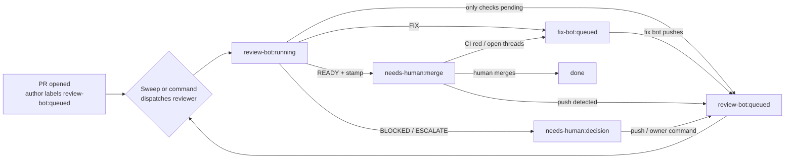

# PR Automation for Agent Owners

How a Hermes agent that owns one or more repos detects PRs awaiting review,
dispatches the review, keeps label state truthful, and routes notifications.
The review itself — what to check and how to judge it — is the
[pull-request skill's Reviewer role](../../skills/pull-request/SKILL.md)
executing the [PR review process](../references/pr-review.md). This document
is only the logistics around it.

---

## Label state machine

Labels plus `reviewed@<sha>` comments are the system of record. They survive
agent restarts, and every sweep tick reconstructs state from them
statelessly — no agent-side memory is required. The label prefix says who
acts next: `review-bot:*` / `fix-bot:*` a bot, `needs-human:*` a person. A PR
carries at most one state label; a bot state that no bot will act on is turned
into `needs-human:decision` with a comment saying what to do.

| Label | Meaning | Set by |
|-------|---------|--------|
| `review-bot:queued` | Waiting for a review of the latest commit | Author when opening the PR; the sweep after a push or a fix round |
| `review-bot:running` | A review bot is working on it | The sweep, on dispatch |
| `fix-bot:queued` | Changes needed (FIX verdict, red CI or open review threads at this commit); the fix bot acts next | Reviewer on FIX; the sweep on red CI |
| `needs-human:merge` | Review passed at the latest commit; only a person merges | Reviewer |
| `needs-human:decision` | A question only a person can answer (BLOCKED, ESCALATE, retries exhausted) | Reviewer, fix bot or sweep |

One **ownership label** sits alongside the state labels. It never replaces them:

| Label | Meaning | Set by |
|-------|---------|--------|
| `fix-bot:owns-branch` | An author-side fix-bot session owns the fix loop (see [Babysit coexistence](#babysit-coexistence)) | The fix-bot session, on start; removed by it on exit, or by the sweep when the claim goes stale |

**Migration.** The earlier names are still read and renamed on sight by the
sweep: `pr:ready-review` → `review-bot:queued`, `pr:in-review` →
`review-bot:running`, `pr:re-review` → `fix-bot:queued`, `pr:ready-merge` →
`needs-human:merge`, `pr:escalated` → `needs-human:decision`, `pr:babysat` →
`fix-bot:owns-branch`. Create the new labels once with
`python3 scripts/gh-project.py labels`.

Transitions:



Label drift (a PR in a wrong or missing state) is corrected by the sweep,
never by alerting the human — except drift on `needs-human:merge` (see failure
policy).

---

## Triggers

Four trigger surfaces, in priority order:

1. **Cron sweep (backbone).** One scheduled job per owning agent covering
   all owned repos. Interval: every 1–2 minutes. The tick is a no-agent
   script (see [The sweep tick](#the-sweep-tick-no-llm)), so every tick
   costs zero LLM tokens and stays far inside GitHub API rate limits.
2. **Owner commands.** A comment whose **first line** is `<handle> review`
   dispatches a Reviewer; `<handle> fix` (also `babysit`) starts an
   author-side round whose prompt carries the comment; `<handle> fix rebase`
   / `fix merge` chooses how the base branch is brought in (merge is the
   default). Free text after the handle, a first line ending in `?`, and the
   bots' own comments are not commands. The handle is `PR_AGENT_HANDLE`
   (default `/devbot`); all scripts parse it through
   [`scripts/commands.py`](../../scripts/commands.py), which accepts common
   spellings (`\devbot fixed`, `/DevBot: review`). An explicit command wins
   over sweep state and caps, once per command; the sweep marks the comment
   as read with an 👀 reaction. Only some people may command the bots: see
   [Who the sweep listens to](#who-the-sweep-listens-to).
3. **Push demotion.** A new commit on a PR labeled `needs-human:merge` or
   `needs-human:decision`, or past a `reviewed@` stamp, moves it to
   `review-bot:queued` (labels updated mechanically; no LLM needed). This
   closes the silent-stale-approval hole: a stamped READY whose branch moved
   is not mergeable advice.
4. **Maintenance rounds.** Without any command, the sweep starts a fix-bot
   round when the PR has merge conflicts or is behind a base that requires
   an up-to-date branch (at most 2 automatic conflict rounds since the owner
   last asked; a PR waiting on a person gets a `merge conflict only` round
   that merges and touches nothing else), when CI turns red at the reviewed
   commit, when a review thread (Copilot or a person) has no answer, and per
   new bot review (see rule 7 below).

Webhook-triggered instant dispatch is the eventual upgrade and is
deliberately deferred. The dispatcher's per-PR decision is a pure function of
the PR's labels and comments, so a webhook handler can call the same logic
for one PR instead of sweeping them all.

---

## Babysit coexistence

The sweep and babysitting are two different jobs, and both are needed:

| | Sweep | Babysit |
|---|---|---|
| Started by | Labels, commands, pushes (always on) | A human asks: chat or `<handle> fix`, or the author's sweep-owned claim at PR open under the delivery pipeline ([rule 7](#rules-that-let-them-run-on-the-same-pr-without-fighting)) |
| Lifetime | Persistent cron | Until READY, PR closed, human stop, escalation, or session end |
| Role | Reviewer logistics: dispatch independent reviews, keep labels truthful | Author: fix findings, reply, push, request re-review |
| Never does | Fix code | Issue a verdict or stamp on its own work |

Rules that let them run on the same PR without fighting:

1. **Claim.** A fix-bot session adds `fix-bot:owns-branch` and posts one claim
   comment, `🤖 fix-bot: owns this branch; session=<id> last-active=<iso-time>`.
   It edits that same comment's `last-active` on every round it processes (it
   does not post a new one). On exit it removes the label and edits the
   comment to say it stopped. The older form `babysit: session=<id>
   heartbeat=<iso-time>` is still read.
2. **What the sweep still does on a claimed PR:** dispatches independent
   Reviewer runs (push demotion to `review-bot:queued` works as usual),
   corrects label drift, and reports stuck states.
3. **What the sweep stops doing on a chat-claimed PR:** dispatching any fix or
   author-side work, and notifying the human about FIX verdicts. The babysitter
   owns those. READY, BLOCKED, and ESCALATE still notify the human.
4. **Handoff.** Babysitter pushes a fix and sets `review-bot:queued`, the
   sweep dispatches a fresh Reviewer, and the Reviewer's verdict comment wakes
   the babysitter. The babysitter therefore watches for new verdict/`reviewed@`
   comments and human comments, not just bot reviews.
5. **Shared bound.** The two-fix-loop limit from the
   [PR review process](../references/pr-review.md) (`PR_FIX_LOOP_CAP`) is
   counted from the PR's FIX verdict history, not per session. A babysitter
   that reaches it escalates. An explicit `<handle> fix` from the owner is a
   ruling for that round and is never limited.
6. **Stale claim.** If the heartbeat is older than `PR_BABYSIT_STALE_MIN`
   (default 60 minutes), the claim is stale. The sweep then
   removes `fix-bot:owns-branch`, treats the PR as a stuck state, and notifies the human
   once. The PR then falls back to normal sweep handling.
7. **Babysit on open.** Under the [Delivery Pipeline](../references/delivery-pipeline.md#4-pr-lifecycle),
   the author posts a sweep-owned claim (`session=babysit-pr…`) when opening
   the PR, so babysitting starts without a command. For sweep-owned claims the
   sweep dispatches one round per new FIX verdict at the current head, one
   round per new completed bot review (e.g. Copilot) while the PR's bot-review
   count is under the cap (**5 per PR**, `PR_BOT_REVIEW_CAP`; bot login(s) in
   `PR_BOT_REVIEWERS`), and one round per CI red→green transition at the
   stamped READY head (the author keeps required checks green; green again
   restores `needs-human:merge`). The round fires with or without an active
   claim — the round posts its own claim; chat-started claims still get no
   twin. Bot reviews never count toward the fix-loop bound; neither do CI
   maintenance rounds.
   Sweep-owned claims are not aged by heartbeat (rule 6 applies to
   chat-started claims only): between rounds nobody is running, by design.
8. **Who owns the round loop.** A babysitter started from chat runs its own
   one-shot watcher, and the sweep must not start a twin. A babysit started by
   the sweep (`<handle> fix`) has no watcher: the sweep re-dispatches one
   round per new FIX verdict at the current head. Sweep-started sessions use
   a reserved session-id prefix in the claim (`session=babysit-pr…`), and
   the sweep only continues claims carrying that prefix.

---

## The sweep tick (no LLM)

The tick is a Hermes cron job in `no_agent` mode: a deterministic script,
[`scripts/pr-sweep-dispatch.py`](../../scripts/pr-sweep-dispatch.py). It reads
GitHub and applies the rules below. Its stdout is the delivery; empty stdout
means a silent tick. The tick exercises no judgment: it decides who works on
a PR, never what the verdict is. So an LLM adds cost and a failure mode (a
model that "just checks" and starts reviewing inside a 3-minute tick) and no
value.

Per PR, each tick:

- **Reads state** from labels and comments only. There is no agent-side
  memory beyond the dispatch record: the one state label, the latest verdict
  marker, the babysit claim heartbeat, and unprocessed owner commands.
- **Selects work.** A Reviewer is wanted when the label is
  `review-bot:queued` with no finished review at this head, when there is an
  unprocessed `review` command, or when the PR is `review-bot:running` but no
  reviewer is running (drift). A review whose only blocker is pending checks
  ends "Waiting for checks", keeps `review-bot:queued`, and runs again when
  the checks finish (at most 3 such reviews per commit, 20 minutes apart; then
  the owner is asked). An author round is wanted on a `fix` command, on a FIX
  verdict at the current head, and on the maintenance triggers above. Drafts
  are skipped. `needs-human:merge` PRs whose verdict head equals the PR head
  are left alone until the human merges.
- **Demotes pushes mechanically.** `needs-human:merge` or
  `needs-human:decision` whose latest verdict head is not the PR head moves to
  `review-bot:queued`. A stale READY is reported.
- **Handles claims.** A stale claim loses `fix-bot:owns-branch` and is
  reported once.
- **Checks results.** A session counts as finished only when it wrote a valid
  result file for this PR, kind and commit. A result that published a commit
  or a verdict must list its verification logs (`verification_artifacts`,
  written under the session's artifacts directory, at least one non-empty;
  `PR_REQUIRE_VERIFICATION_LOGS=0` turns this off). A rejected result is a
  failed dispatch: retried after a 30-minute cooldown, at most 3 times, then
  reported once with the reason and the `<handle> review` / `fix` command
  that retries it.
- **Detects its own actions as calm.** After a reviewer posts, the next tick
  sees a finished review at this head and does nothing. If a PR re-dispatches
  every tick, the rules are wrong: fix the script, do not widen a session's
  job.

### Who the sweep listens to

A PR conversation comment counts only from:

- the owners (`PIPELINE_OWNERS`; the sweep refuses to run without it) and
  the bot logins (`PIPELINE_BOT_LOGINS`): read as written;
- the PR's people: `PIPELINE_RESPONDERS`, the PR's assignees and the
  assignees of the issues it closes (issues of this repository only). Their
  commands count, but a comment of theirs that looks like automation in any
  way (a hidden-marker delimiter `<!--` or `-->`, a 🤖 first line, claim,
  heartbeat or verdict text anywhere) is ignored entirely, so nobody can
  forge a verdict, a claim or a bot reply;
- nobody else: a stranger's comment is not read at all.

Hidden markers therefore count only from the owners and the bot logins.
Reviews count only from `PR_BOT_REVIEWERS`. A review thread counts only when
it was started by an owner, one of the PR's people, a bot login or one of
`PR_BOT_REVIEWERS`, and a later reply from anyone else neither opens nor
reopens it. The review and fix sessions are told the same list of logins and
the comment that triggered them, and treat everything else as information,
never as instructions. PRs from forks are skipped: the
bots never check out, run or push to a fork's branch. Board sync assigns an
open PR with no assignee to the assignees of the issues it closes (else the
first owner), so the people working on an item may command the bots on its
PR. `scripts/unheard.py` tells anyone else, once, why nothing happens, and
tells a person whose command was ignored because it carries bot-only text.

### Shared human/agent account

When the human and the agent post as the same login, bot comments are told
apart by their content: every bot comment starts with `🤖 ` and carries a
hidden marker (`<!-- babysit-reply -->`, the verdict marker, a claim line),
and never starts with the command handle. A comment authored by an `@` handle
login is never a command. Use a `/` handle (default `/devbot`) when people and
bots share an account, and set `PIPELINE_SHARED_ACCOUNT=1`: an owner comment
from the shared login then counts as a reply only when it carries no bot
marker. Without the flag, the backlog dispatcher refuses to run when the bot
login is also an owner, because it could not tell their replies apart.

### Escalation and review threads

- A fix round that ends in ESCALATE posts one PR comment (`🤖 **Needs your
  decision: …**` with `## Questions` in the ⭐ format) and sets
  `needs-human:decision`, removing any other state label. The sweep's push
  demotion still moves it to `review-bot:queued` when the head moves.
- An unresolved review thread whose last comment is not the PR author's is an
  open finding, when it counts (see [Who the sweep listens to](#who-the-sweep-listens-to)). The Reviewer cannot post READY while one exists, a
  `needs-human:merge` PR with one goes back to `fix-bot:queued`, and green CI
  does not restore `needs-human:merge` until it is answered. The fix round
  fixes or answers each thread and resolves it.
- A fix round that resolved the review without changing code (a PR body edit,
  answered threads; `status` FIXED with `addressed_without_code` true at the
  same head) gets one fresh review of that head, since no push demotion fires.
- Checks named in `PR_HUMAN_CHECKS` (for example a merge-label check) are
  never treated as code failures and never awaited.

## Dispatch: the tick never reviews inline

Hermes cron agent runs are hard-interrupted at 3 minutes. A real review —
checkout, rule pass, verification commands — does not fit. Therefore:

- The sweep tick's only job: **dispatch one background review task per
  actionable PR**, each running
  the pull-request skill's Reviewer role with the PR number, repo, and the
  repo's manifest path as inputs.
- **The vehicle is a detached Hermes session**, not in-process delegation.
  A `delegate_task` child lives inside the tick's process and dies with it.
  Launch a separate process instead:
  `hermes chat -Q --oneshot --query-file <prompt> --source tool
  --reasoning <level> -s <skills> [-m <model>] [--provider <provider>]`, started
  with a new session (`setsid` / `start_new_session`) and stdin closed. The
  session is re-parented to init and outlives the tick. Use a strong model
  for the Reviewer (it produces the verdict of record) and a cheaper one for
  author-side babysit rounds.
- **Result file.** Each session writes
  `pr-automation/results/<tag>.json` (`repo`, `kind`, `pr`, `head`,
  `input_head`, `verdict`/`status`, `verification_artifacts`,
  `owner_decision`, `summary`, `url`, `notify`). A later tick delivers it as the READY /
  BLOCKED / ESCALATE digest. A dispatch whose process is gone without a
  result file counts as a failed dispatch.
- **One dispatch record per tick**, written before spawning
  (e.g. `~/.../pr-automation/dispatches.jsonl`: timestamp, repo, PR, head
  SHA, session tag, pid). The record makes re-dispatches idempotent: a PR
  with a finished or running review at a given head SHA is not dispatched
  again, and each command comment is processed once.
- **Reviews may take arbitrarily long** — they run outside the cron tick.
  The next sweep sees their label/stamp effects, not their runtime.

---

## Verdict marker

Reviewer comments end with a machine-readable marker so the sweep can parse
state without an LLM:

```
**Verdict: READY|FIX|BLOCKED**
<!-- pr-review verdict=READY|FIX|BLOCKED head=<full sha> -->
reviewed@<full sha>          (READY only)
```

The sweep uses the marker for push demotion (a verdict whose `head` differs
from the PR head is stale), for the shared two-fix-loop bound (count of
`verdict=FIX` markers), and for babysit hand-off (a new FIX marker at the
current head triggers the next babysit round).

---

## Failure policy

- **Never half-post.** A reviewer that dies mid-run (provider timeout,
  iteration cap) must not leave a partial review comment or a label it did
  not earn. Post-verify after any dispatch failure: if the agent's working
  note says it posted, confirm the comment exists before trusting the
  label; on mismatch, remove the label and let the sweep re-dispatch.
- **Retry on next tick.** A failed dispatch is simply retried by the next
  sweep (the dispatch record prevents double-dispatch at the same head SHA;
  a new SHA always re-fires).
- **Escalate stuck states.** A PR in `review-bot:running` across more than one
  sweep with no progress, or repeated dispatch failure at the same SHA
  (3+ times), is reported to the human as an automation failure — not
  silently retried forever.
- **Notify the human only on**: stale babysit claims, READY digests (per the loop rules in the
  PR review process), BLOCKED/ESCALATE questions, label drift on
  `needs-human:merge`, and stuck states. When the sweep itself hands a PR to
  a person it posts one PR comment in the
  [comment style](../references/comment-style.md), deduplicated per commit
  and reason. FIX loops stay silent (bounded at
  two, per the process).

---

## Boundaries

- **Agents never merge.** `needs-human:merge` is a human decision surface. The
  agent's READY digest is the full case for merging; the human merges (or
  asks the agent to, explicitly, case by case).
- **The sweep is an accelerator, not a reviewer of record.** Verdicts come
  only from a properly dispatched independent reviewer run. Automation
  never stamps `reviewed@<sha>` itself.
- **Base-branch hygiene.** Never `--delete-branch` a merge while other open
  PRs use that branch as base (GitHub auto-closes them, unreopenably).
  Sweep merges — if the human delegates any — must re-target dependents
  first.
- **Canonical policy wins.** If logistics here ever conflict with
  [pr-review.md](../references/pr-review.md), pr-review.md wins; fix this
  doc.

---

## Sweep cron template

Copy per owning agent. Everything the tick does is in the script; the process
contract is read from the repo by the sessions it launches.

```
hermes cron create "every 2m" --no-agent --script pr-sweep-dispatch.py --name pr-sweep

Install:  copy scripts/*.py, scripts/pr-sweep-prompts/ and scripts/pipeline-prompts/
          into $HERMES_HOME/scripts/ (the dispatchers import commands.py and
          comment_style.py from their own directory; sessions post through post-comment.py)
Env:      PR_SWEEP_REPOS="owner/repo-a owner/repo-b"   PR_AGENT_HANDLE="/devbot [@login ...]"
          PIPELINE_OWNERS (required: the logins who command the bots), PIPELINE_RESPONDERS
          PIPELINE_WIP (2; author sessions shared with the pipeline's work sessions, whose
          state PIPELINE_STATE names), PIPELINE_QUIET_HOURS / _WEEKENDS / _MODES, PIPELINE_FORCE
          PR_REVIEW_MODEL (strong)  PR_BABYSIT_MODEL (cheaper)  PR_REVIEW_REASONING
          PR_REVIEW_SKILLS / PR_BABYSIT_SKILLS (add repo overlay skills)
          PR_SESSION_PROVIDER, PR_SWEEP_CHECKOUT_ROOT (local checkouts, default ~/repos)
          PR_FIX_LOOP_CAP (2), PR_BOT_REVIEWERS, PR_BOT_REVIEW_CAP (5), PR_HUMAN_CHECKS
          PR_BABYSIT_STALE_MIN (60), PR_REVIEW_STUCK_MIN (90), PR_STALL_NOTIFY_MIN (60)
          PIPELINE_BOT_LOGINS (bot accounts whose thread replies answer a thread;
          default: the @ handles, else the account gh is logged in as)
          PR_REQUIRE_VERIFICATION_LOGS (1; logs must sit in the round's artifacts dir), PR_SWEEP_STATE
          HERMES_BIN / GH_BIN / GH_TOKEN_FILE as the host needs
          COMMENT_STYLE_ENFORCE_FROM (ISO date; post-comment.py only warns before it)
Deliver:  the channel where the human wants READY / BLOCKED / ESCALATE digests
```

When every repository fails on a tick, the sweep sends one `🛑 PR sweep
stopped` alert, repeats it at most hourly, and sends one line when it runs
again; one failing repository repeats its error at most once per 6 hours.

`PR_SWEEP_DRY=1` prints the actions a tick would take without mutating GitHub
or the dispatch record. Run it once before enabling the cron. The session
prompts in `scripts/pr-sweep-prompts/` carry the logistics (worktree, exactly
one comment posted through `post-comment.py`, verdict marker, labels via REST,
verification logs, result file). The
review itself is the `pull-request` skill executing
`docs/references/pr-review.md`, read from the repo at run time and never
restated in the prompt.

### Opt-in vs drift

By default (`PR_SWEEP_UNLABELED=ignore`) an unlabeled PR with no workflow
label (`review-bot:*`, `fix-bot:*`, `needs-human:*`), no `fix-bot:owns-branch`
claim, no prior bot verdict or dispatch, and no `<handle> review` / `<handle>
fix` command is **ignored** completely — no reviews, no automatic fix rounds
(including `PR_BOT_REVIEWERS` / Copilot reviews, CI, or merge conflicts), and
no alerts (such as `botcap` or cancelled checks). Otherwise, in a repo with
existing open PRs, the first tick would act on teammates' PRs that never
opted in. Set `PR_SWEEP_UNLABELED=review` to treat an unlabeled PR as drift
awaiting review.

Setup is step 2 of the [self-setup checklist](README.md#agent-self-setup-checklist).
